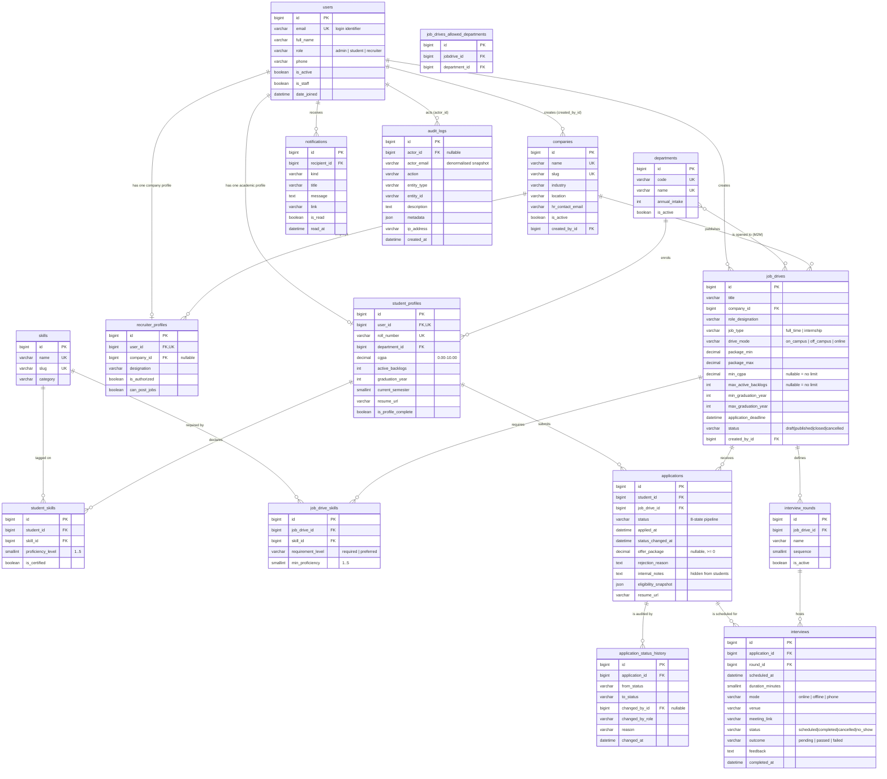

# Entity–Relationship Diagram

The diagram below is generated from the real Django models
(`backend/<app>/models.py`). Every entity maps to a physical table whose
`db_table` name is shown in the `[table]` label, so the picture and
`docs/DATABASE_SCHEMA.md` describe the same database.

Cardinality legend: `||--o{` one-to-many (mandatory one side),
`||--o|` one-to-zero-or-one, `}o--o{` many-to-many.

---

## Integrity rules shown in the diagram

These are enforced by the database, not only by application code.

| Table | Rule | Kind |
|---|---|---|
| `users` | `email` unique; `(role, is_active)` indexed | UNIQUE + INDEX |
| `student_profiles` | `roll_number` unique; `user_id` unique (1-to-1); `cgpa` validated 0–10 | UNIQUE + CHECK |
| `recruiter_profiles` | `user_id` unique; `(company, is_authorized)` indexed | UNIQUE + INDEX |
| `departments` | `code` and `name` unique | UNIQUE |
| `companies` | `name` and `slug` unique; `(is_active, industry)` indexed | UNIQUE + INDEX |
| `skills` | `name` and `slug` unique | UNIQUE |
| `student_skills` | `UNIQUE(student_id, skill_id)` — no duplicate skill rows | UNIQUE |
| `job_drives` | `(status, application_deadline)`, `(company, status)` indexed | INDEX |
| `job_drive_skills` | `UNIQUE(job_drive_id, skill_id)` | UNIQUE |
| `applications` | `UNIQUE(student_id, job_drive_id)` — one application per student per drive | UNIQUE |
| `applications` | `CHECK (offer_package IS NULL OR offer_package >= 0)` | CHECK |
| `application_status_history` | `(application_id, changed_at)` indexed | INDEX |
| `interview_rounds` | `UNIQUE(job_drive_id, sequence)` — rounds cannot share a number | UNIQUE |
| `interviews` | `(status, scheduled_at)`, `(round, scheduled_at)` indexed | INDEX |
| `notifications` | `(recipient_id, is_read, created_at)` indexed for the badge count | INDEX |
| `audit_logs` | `(entity_type, entity_id)` and `(action, created_at)` indexed | INDEX |

### Referential actions

| Relationship | `ON DELETE` | Rationale |
|---|---|---|
| `student_profiles → users` | `CASCADE` | deleting an account removes its profile |
| `applications → student_profiles` | `CASCADE` | a removed student cannot hold applications |
| `applications → job_drives` | `CASCADE` | drives are only deletable with no applications (blocked in the view) |
| `job_drives → companies` | `PROTECT` | a company with drives cannot be deleted (the view deactivates it) |
| `interviews → interview_rounds` | `PROTECT` | a round with bookings cannot be deleted |
| `audit_logs → users` | `SET NULL` | the trail must outlive the account (hence `actor_email`) |
| `job_drives → users (created_by)` | `SET NULL` | deleting an officer must not delete historical drives |
